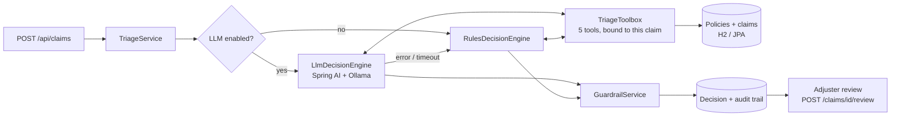

# Agentic AI Claims Triage

A Spring Boot service that triages new insurance claims (first notice of loss) with an **LLM agent**.
The agent calls tools to check the policy, coverage, claim history, fraud signals and severity, then
routes the claim to the right work queue and writes a summary for the adjuster.

Hard business rules sit **outside** the model as guardrails, every tool call is saved as an audit
trail, and an adjuster can confirm or override any decision.

**Stack:** Java 21 · Spring Boot 3.5 · Spring AI 1.0 (tool calling + structured output) · Ollama
(local `qwen2.5:7b`) · Spring Data JPA · H2 · JUnit 5 / MockMvc / Mockito · Docker

---

## What it does, in 5 steps

1. **A claim comes in** — `POST /api/claims` with policy number, loss type, dates, amount and a free-text description.
2. **The agent investigates** — the LLM decides which tools to call:

   | Tool | What it checks |
   |---|---|
   | `lookupPolicy` | Holder, product, status, covered perils, limit, deductible |
   | `checkCoverage` | Is this loss type covered? Was the policy in force on the loss date? Estimated payable |
   | `getClaimHistory` | Prior claims on the policy in the last 12 months |
   | `assessFraudSignals` | Late reporting, loss soon after policy start, frequent claims, amount near limit, red-flag phrases → 0–100 score |
   | `estimateSeverity` | LOW / MEDIUM / HIGH / CATASTROPHIC from amount and description (injury, uninhabitable…) |

3. **The agent proposes a decision** — queue, severity, fraud score, confidence, a summary and reasons, returned as structured JSON.
4. **Guardrails check it** — deterministic rules correct anything unsafe (see below). If the model is down, slow or returns junk, a **rules engine fallback** makes the decision instead.
5. **A human closes the loop** — anything not fast-tracked lands in `PENDING_HUMAN_REVIEW`; an adjuster confirms or overrides it, and the agreement rate is tracked.

### Work queues

| Queue | When |
|---|---|
| `FAST_TRACK` | Severity LOW, fraud < 30, amount ≤ 5,000 |
| `STANDARD_ADJUSTER` | Everything else that's covered |
| `SENIOR_ADJUSTER` | Severity HIGH/CATASTROPHIC, or fraud ≥ 40 |
| `SPECIAL_INVESTIGATIONS` | Fraud ≥ 70 |
| `DENIAL_REVIEW` | Not covered / policy inactive — always a human, the agent never denies on its own |

---

## Architecture



### Design decisions worth talking about in an interview

- **The LLM can escalate, never de-escalate.** `RoutingRules` computes the *minimum* queue a claim is allowed in.
  The model may route higher (e.g. it spots an inconsistent story the keyword rules missed), but the guardrails
  pull anything below the floor back up. Coverage status always comes from the coverage check, not the model,
  and fraud/severity can be raised by the model but not lowered.
- **Tools are bound to one claim.** A new `TriageToolbox` is created per run with the claim baked in, so the model
  can't read another customer's policy. `lookupPolicy` refuses any other policy number.
- **Ground truth vs. what the model says it saw.** Guardrails use `toolbox.facts()` (computed in code), not numbers
  copied out of the model's reply.
- **Graceful degradation.** The LLM call runs on a virtual thread with a timeout; on any failure the rules engine
  decides and the decision is tagged `RULES_ENGINE` with a note explaining why.
- **No DB transaction held during the LLM call.** Triage runs first; only the writes are transactional.
- **Prompt-injection hygiene.** Claim text is untrusted, so template characters are stripped before it reaches the prompt.
- **Auditability.** Every tool call (input + output JSON) is stored in `agent_steps`; every decision keeps its source
  (`LLM_AGENT` / `RULES_ENGINE` / `HUMAN`), model name, latency and guardrail notes.
- **Measured, not vibes.** An 18-claim labelled eval set (`src/main/resources/eval/claims-eval.json`) reports
  accuracy, a confusion matrix, latency and **under-routed** claims (the dangerous mistake).

---

## Run it — step by step

### Step 1: Install the basics
- Java 21 and Maven 3.9+ (or just open the folder in IntelliJ, which bundles Maven)
- [Ollama](https://ollama.com/download)

### Step 2: Pull a model that supports tool calling
```bash
ollama pull qwen2.5:7b      # ~4.7 GB, fits comfortably in 12-16 GB VRAM
```
Other options: `llama3.1:8b`, `qwen2.5:14b` (better reasoning, slower). Set `OLLAMA_MODEL` to switch.

### Step 3: Run the tests (no model needed)
```bash
mvn test
```
Tests run with the LLM switched off and use a Mockito mock to simulate a misbehaving model.

### Step 4: Start the app
```bash
mvn spring-boot:run
```
- Swagger UI: http://localhost:8080/swagger-ui.html
- H2 console: http://localhost:8080/h2-console (JDBC URL `jdbc:h2:mem:claims`, user `sa`)
- Six demo policies (`POL-1001` … `POL-1006`) are seeded on startup.

No GPU handy? Run with rules only:
```bash
TRIAGE_LLM_ENABLED=false mvn spring-boot:run
```

### Step 5: Send some claims
Open `requests.http` in IntelliJ or VS Code (REST Client) and click through the examples, or:
```bash
curl -s -X POST localhost:8080/api/claims -H 'Content-Type: application/json' -d '{
  "policyNumber":"POL-1006","claimantName":"Meera Krishnan","lossType":"THEFT",
  "lossDate":"2026-08-28","claimedAmount":22000,
  "description":"Car was stolen from my friend'"'"'s garage while I was travelling. There is no police report filed yet."}'
```

### Step 6: Run the evaluation
```bash
curl -s -X POST localhost:8080/api/eval/run
```
Run this on a fresh start — claims you submit become "claim history" and can shift fraud scores.

### Docker (optional)
```bash
docker compose up -d ollama
docker compose exec ollama ollama pull qwen2.5:7b
docker compose up --build app
```

---

## API

| Method | Path | Purpose |
|---|---|---|
| POST | `/api/claims` | Submit a claim; it is triaged immediately |
| GET | `/api/claims?status=&queue=` | Work queues |
| GET | `/api/claims/{id}` | Claim + latest decision |
| GET | `/api/claims/{id}/decisions` | All decisions (agent runs + human reviews) |
| GET | `/api/claims/{id}/trace` | Audit trail of tool calls |
| POST | `/api/claims/{id}/triage` | Re-run triage |
| POST | `/api/claims/{id}/review` | Adjuster confirms / overrides routing |
| POST | `/api/eval/run` | Run the labelled eval set |
| GET | `/api/eval/review-agreement` | Human–agent agreement rate |
| GET | `/api/policies` | Demo policies |

---

## Project layout

```
agent/            LLM engine, rules engine, guardrails, routing rules, toolbox, audit trace
agent/tools/      ClaimAnalyzer (pure business checks) + tool result records
service/          TriageService (orchestration + fallback), ClaimService (API + human review)
eval/             EvalService - accuracy, confusion matrix, under-routing
web/              REST controllers, DTOs, RFC 7807 error handling
config/           Typed config properties, demo data seeder
```

## Ideas for v2
- Swap H2 for PostgreSQL and add Flyway migrations
- Publish `ClaimTriaged` events to Kafka for downstream systems
- Add a document-reading tool (police report / invoice PDF) with a vision model
- Compare models on the eval set (`qwen2.5:7b` vs `llama3.1:8b` vs `qwen2.5:14b`)
